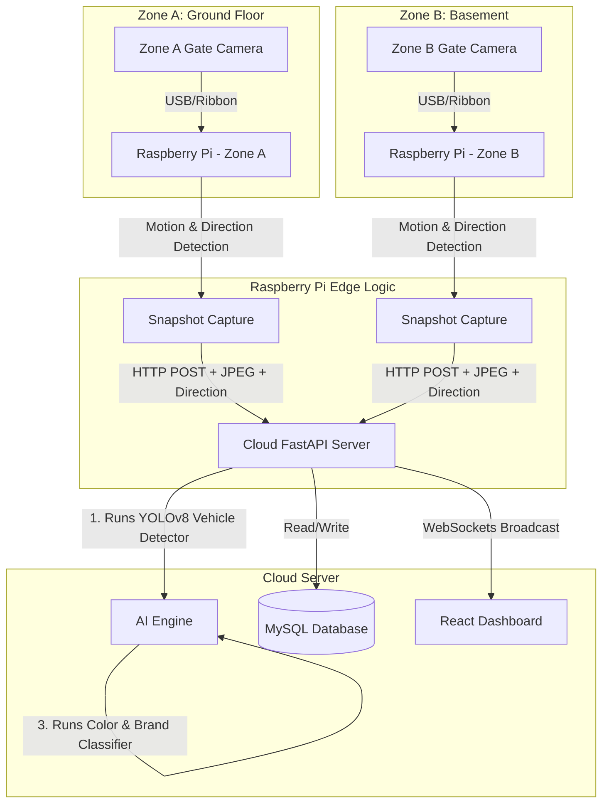

# Vehicles Visits Tracker - Implementation Plan

This document outlines the architecture, hardware and software requirements, database design, and step-by-step implementation plan for the Vehicle Visits Tracker. The system tracks vehicle entries and exits for a workshop with two zones (Ground Floor Showroom/Tenting & Basement Wash/Denting/Painting) using Raspberry Pi cameras, a self-hosted open-source AI engine, and a real-time React dashboard.

## System Architecture Diagram



---

## Hardware Requirements

### 1. Edge Devices (Raspberry Pi & Cameras)
Because the workshop has two distinct zones (Ground Floor and Basement), we recommend using **two Raspberry Pi controllers**—one for each floor. Each zone has a single dual-purpose gate (for both Entry and Exit), requiring one camera per zone (2 cameras total).

*   **2x Raspberry Pi 4 Model B (4GB)** or **Raspberry Pi 5 (4GB)**
*   **2x Cameras**:
    *   *Option A (Recommended for simplicity)*: **High-Definition USB Webcams** (1080p, autofocus, with good low-light/night performance). Standard USB extension cables (active cables if >5m) can be used.
    *   *Option B*: **Raspberry Pi Camera Module 3** (requires short ribbon cables, suitable if the Pi is mounted right next to the camera).
*   **2x Waterproof enclosures & mounts** to protect cameras from dust, paint spray, and car wash mist.
*   **Power Supplies**: Official USB-C power adapters (15W for Pi 4, 27W for Pi 5).
*   **Storage**: 2x High-end 32GB MicroSD Cards (SanDisk Extreme or similar Class 10/U3).
*   *Direction Detection & Trigger Options*:
    *   *Option A (Software-only)*: OpenCV-based optical flow or bounding box tracking to determine whether the vehicle is entering (approaching) or exiting (receding).
    *   *Option B (Sensor-based)*: **2x Pairs of Ultrasonic/Infrared Sensors** per gate. Spaced 1-2 meters apart, the sequence of triggers determines the direction: Sensor 1 first = Entry, Sensor 2 first = Exit.

### 2. Server Infrastructure (Hosting & AI)
Since the AI models (YOLOv8 + EasyOCR) will run server-side, the server needs sufficient RAM and CPU cores.
*   **Cloud VPS** (e.g., DigitalOcean, AWS EC2, Hetzner, Linode)
    *   **Minimum**: 2 vCPUs, 4 GB RAM, 50 GB SSD (Ubuntu 22.04 LTS).
    *   **Recommended**: 4 vCPUs, 8 GB RAM (runs YOLOv8 model inference faster and smoother).
*   **MySQL Database Instance** (can be hosted on the same server to save costs).

---

## Software Requirements

### 1. Raspberry Pi (Edge Client)
*   **OS**: Raspberry Pi OS (64-bit Lite, headless).
*   **Core Libraries**:
    *   `python3` (3.10+)
    *   `opencv-python-headless` (for motion detection & camera capture).
    *   `requests` (to upload snapshots to the backend API).

### 2. Cloud Backend Server
*   **Framework**: **FastAPI** (Python 3.10+). High performance, async database operations, built-in WebSockets.
*   **Database ORM**: **SQLAlchemy** or **Tortoise-ORM** connecting to **MySQL**.
*   **AI Engine**:
    *   `ultralytics` (YOLOv8) for vehicle detection, license plate detection, and brand/color categorization.
    *   `easyocr` for optical character recognition of the license plate characters.
*   **Real-time Communication**: WebSockets (native in FastAPI).
*   **Authentication**: `jose` (JWT tokens) and `passlib` (password hashing) for Admin dashboard security.

### 3. Frontend Web App
*   **Framework**: **React + Vite** with TypeScript.
*   **Styling**: **Vanilla CSS / Custom Glassmorphism** (modern, beautiful, tailored theme).
*   **Communication**: WebSocket Client (reconnecting websocket) and Axios (API client).

---

## Database Design (MySQL)

```sql
-- 1. Users Table (Admin Access)
CREATE TABLE users (
    id INT AUTO_INCREMENT PRIMARY KEY,
    username VARCHAR(50) NOT NULL UNIQUE,
    password_hash VARCHAR(255) NOT NULL,
    created_at TIMESTAMP DEFAULT CURRENT_TIMESTAMP
);

-- 2. Vehicles Table (Owner and vehicle master records)
CREATE TABLE vehicles (
    plate_number VARCHAR(20) PRIMARY KEY, -- Cleaned uppercase, no spaces
    color VARCHAR(30),
    brand VARCHAR(50),
    owner_name VARCHAR(100),
    owner_phone VARCHAR(20),
    owner_email VARCHAR(100),
    created_at TIMESTAMP DEFAULT CURRENT_TIMESTAMP,
    updated_at TIMESTAMP DEFAULT CURRENT_TIMESTAMP ON UPDATE CURRENT_TIMESTAMP
);

-- 3. Visits Table (Tracks entries and exits)
CREATE TABLE visits (
    id INT AUTO_INCREMENT PRIMARY KEY,
    plate_number VARCHAR(20) NOT NULL,
    zone VARCHAR(10) NOT NULL, -- 'Zone A' or 'Zone B'
    entry_timestamp TIMESTAMP DEFAULT CURRENT_TIMESTAMP,
    exit_timestamp TIMESTAMP NULL,
    entry_image_url VARCHAR(255),
    exit_image_url VARCHAR(255),
    status VARCHAR(20) DEFAULT 'Inside', -- 'Inside', 'Completed'
    manually_created BOOLEAN DEFAULT FALSE,
    manually_edited BOOLEAN DEFAULT FALSE,
    FOREIGN KEY (plate_number) REFERENCES vehicles(plate_number) ON UPDATE CASCADE
);
```

---

## Proposed Implementation Plan

The implementation is divided into four main phases:

### Phase 1: Database Setup & FastAPI Backend (Core AI Engine)
1.  **MySQL Database Setup**: Write migration scripts to initialize the database tables on the cloud MySQL.
2.  **API Framework**: Set up FastAPI structure with routes for:
    *   `/api/auth`: Login and session management.
    *   `/api/vehicles`: Get/edit vehicle & owner details.
    *   `/api/visits`: Log visits manually, edit details, fetch daily statistics.
    *   `/api/capture`: Endpoint for RPi to upload a snapshot. Trigger YOLOv8 & EasyOCR pipeline immediately when an image is received.
3.  **AI Engine Integration**:
    *   Deploy YOLOv8 (nano or medium model) to detect vehicles and crop license plates.
    *   Deploy EasyOCR to parse characters from the license plate crop.
    *   Use a lightweight YOLOv8 classification model or ResNet model for vehicle brand/color recognition.
4.  **WebSocket Server**: Implement a broadcast room that sends updates to connected dashboard clients whenever a new capture API request is successfully processed.

### Phase 2: Raspberry Pi Edge Client Setup
1.  **Camera Config**: Write a Python script (`edge_tracker.py`) utilizing OpenCV to connect to the single gate camera on the Pi.
2.  **Trigger & Direction Logic**:
    *   *Sensor-Based Trigger*: Monitor the GPIO pins connected to the dual sensors. Use their trigger order (Sensor 1 -> Sensor 2 for entry, Sensor 2 -> Sensor 1 for exit) to establish the direction.
    *   *Software-Based Trigger*: Use OpenCV frame-differencing. When motion is detected, track the object trajectory (e.g., optical flow or bounding box centroids) to determine the direction (approaching the camera = Entry, moving away = Exit).
    *   Capture a high-resolution snapshot once the license plate is in clear view, and upload it via POST to `/api/capture` with the zone (A or B) and established direction (Entry or Exit).
3.  **Resilience**: Implement offline caching (if internet goes down, save snapshots locally and upload them chronologically when connection restores).

### Phase 3: React Web App (Modern Dashboard)
1.  **UI Design**: Beautiful glassmorphic design featuring:
    *   **Overview Cards**: Vehicles inside now, Total entries today, Total exits today.
    *   **Real-time Event Feed**: Slide-in cards of recent scans with photo, plate, color, brand, and status badge (Entered/Exited).
    *   **Owner / Vehicle Management**: Interface to view all registered vehicles, search by plate, and edit owner information.
    *   **Manual Entry Modal**: Allow managers to manually log an entry/exit or modify plate/brand/color if the AI made a mistake.
2.  **State Management**: Set up a WebSocket connection that automatically updates the dashboard metrics and feeds in real time.

### Phase 4: Local Setup, Testing & Deployment
1.  **Local Testing Environment**: Configure the backend and database to run locally on your Windows laptop.
2.  **AI Model Setup**: Download YOLOv8 weights locally and test EasyOCR performance.
3.  **RPi Simulator Script**: Create a simulation script (`test_sender.py`) to run on the laptop, reading test images of cars and sending them to the local API to verify the AI pipe and dashboard websocket updates.
4.  **Online Migration**: Once verified locally, deploy the FastAPI app and MySQL database to the cloud server and point the RPi client config to the online URL.

---

## Local Windows Laptop Development Setup

To test the entire system locally on your Windows laptop before migrating online, we will use the following structure:

1.  **Local Database**: Install and run MySQL locally on Windows (via XAMPP, Docker, or MySQL Community Server).
2.  **Local Backend (FastAPI)**: Run FastAPI with `uvicorn main:app --reload`. It will run the YOLOv8 and EasyOCR models locally on your laptop (which will be faster than a basic cloud VPS due to your laptop's CPU/GPU).
3.  **Local Frontend (React + Vite)**: Run Vite on `http://localhost:5173`.
4.  **RPi Simulation**: Since you might not have the Raspberry Pi cameras mounted yet, we will write a `test_sender.py` script that takes any sample image of a car from a folder and POSTs it to the local API `http://127.0.0.1:8000/api/capture`. This simulates the camera triggers perfectly.
5.  **Local Network Testing**: When the Raspberry Pi is ready, connect both your laptop and the Pi to the same Wi-Fi network. Configure the Pi script to send captures to `http://<YOUR_LAPTOP_IP>:8000/api/capture`.

---

## Verification Plan

### Automated Tests
- FastAPI route unit tests (mocking AI inference).
- Database CRUD operation checks.
- EasyOCR accuracy validation script using sample test images.

### Manual Verification
- Testing RPi trigger: Drive a vehicle past the camera, check if the snapshot is taken, sent, processed, and displayed on the WebApp within 2-3 seconds.
- Verify editing vehicle owner information updates the client immediately.
- Test manual overrides: Create a fake plate log and edit it, ensuring the "manually_edited" flag is set to true in the database.
